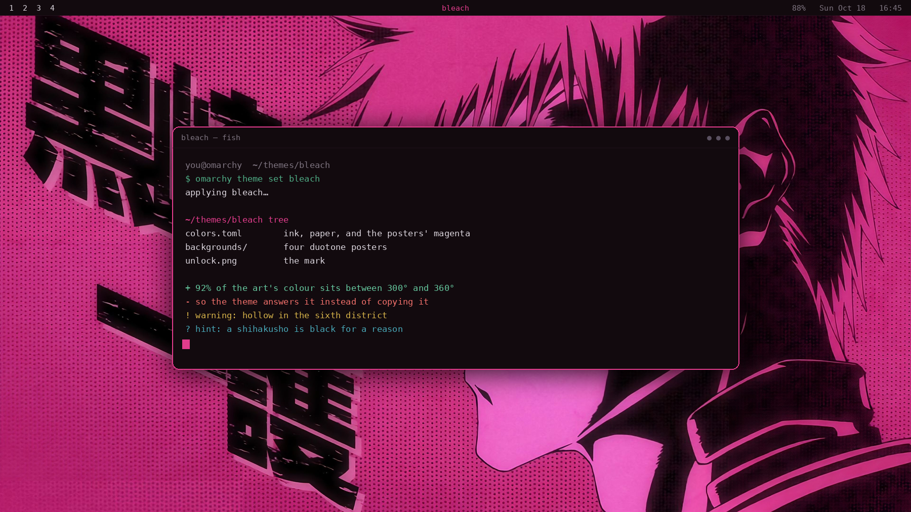

# Bleach

**A dark theme that answers its own artwork instead of copying it.**

The wallpapers are a set of Bleach promo posters printed in two colours: a warm
near-black and a magenta ramp, halftone dots, the character's name in heavy
kanji. Measured across all four, **92% of the saturated pixels fall between 300°
and 360° of hue**. The art has already spent the entire pink budget, so this
palette spends its elsewhere and keeps the magenta for where it earns
attention.



## The palette

The neutrals lean **violet** (285°), not magenta — a cool black that sits beside
the posters without competing with them. Black and white carry the theme, which
is also Bleach's own language: the black shihakushō, the white captain's haori,
a Hollow's mask. The rest is built on the far side of the colour wheel.

| Role | Value | Where it comes from |
| --- | --- | --- |
| `background` | `#120A0E` | the posters' own near-black, taken straight off them |
| `foreground` | `#DCD6DE` | paper white, a whisper of violet — 13.7:1 |
| `accent` | `#E23C8C` | the posters' magenta, lifted until it can carry UI text |
| `green` | `#4FAE86` | **magenta's complement** (155°) — the counterweight |
| `cyan` | `#48A8B8` | split-complement, for teal |
| `blue` | `#6B82D8` | reiatsu indigo, the third leg of the same split |
| `magenta` | `#D9569E` | the posters' own pink, reserved so the accent stays an accent |
| `brown` | `#9A5560` | oxblood — the posters' shadow magenta (`#5F1F3A`) grown up |
| `selection` | `#3A1B2C` | wine-dark, because a grey one would look borrowed |

The accent was the one value adjusted for legibility: the posters' core magenta
measures `#CB3168`, which is 3.4:1 on ink and too quiet for a highlighted bar.
It is lifted along its own hue, and nothing else moved.

Amber (`#D8B44A`) and burnt orange (`#D97A3C`) turn out to meet the orange key
art in `07`; the violet neutrals meet the night city in `06`. The palette covers
the whole set better than it was designed to.

## Install

```bash
omarchy theme install https://github.com/signaldirective/bleach
omarchy theme set bleach
```

Or clone into `~/.config/omarchy/themes/bleach/` and select it with
`omarchy theme set bleach`.

## What's included

- `colors.toml` — the palette, and the source of truth for the shell, terminals
  (Alacritty, Foot, Ghostty, Kitty), btop, Chromium, Hyprland borders, Neovim,
  Helix, VS Code and the lock screen. Omarchy generates all of those from it.
- `backgrounds/` — eight images: four magenta duotone posters and four more.
- `unlock.png` and `preview-unlock.png` — the wordmark struck through by a
  blade, for `Style > Unlock` and the boot screen.
- `icons.theme` — `Yaru-magenta-dark`.
- `tools/theme-art.py` — the script that drew the mark, the preview, and the
  boot screen preview.
- `about.txt` and `screensaver.txt` — ASCII art kept with the theme.

### The wallpapers

| File | What it is |
| --- | --- |
| `01.jpg` | Ichigo (黒崎一護), magenta duotone |
| `02.jpg` | Chad (茶渡泰虎) |
| `03.jpg` | Orihime (井上織姫) |
| `04.jpg` | Ishida (石田雨竜) |
| `05.png` | a fifth duotone poster, magenta into red |
| `06.png` | a character against a purple night city |
| `07.png` | key art: the logo over orange |
| `08.png` | key art in black and white |

The four posters are 3840×2180, which is 0.9% off 16:9 — invisible once a
wallpaper setter scales it to fill, so they were left untouched rather than
cropped to a rounder number.

### The mark

`unlock.png` is drawn by hand, not the official logo: BLEACH in heavy condensed
capital with a magenta blade struck through it, echoing the slash the real
wordmark uses. `tools/theme-art.py` also renders a `死神` (shinigami) variant to
`/tmp` if you would rather have kanji on the boot screen — tell me and I will
swap it in.

## Icons

`icons.theme` is set to `Yaru-magenta-dark`, which carries the accent through
the file manager without the folders shouting over the posters.

## Regenerating the art

```bash
python3 tools/theme-art.py
```

Every colour is read from `colors.toml` through `omarchy-theme-color`, so the
preview and the mark follow the palette rather than duplicating it.

## Credits

Bleach is the work of Tite Kubo; the posters, key art and logo belong to their
rights holders. This is a personal fan theme — the configuration and scripts are
GPL-3.0, the artwork is not mine to license.

## Support

[Tip me on Ko-fi](https://ko-fi.com/signaldirective)
